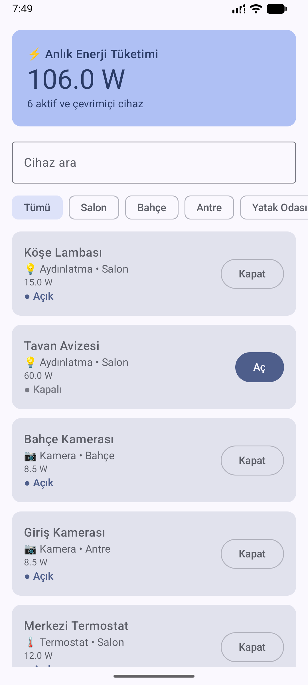
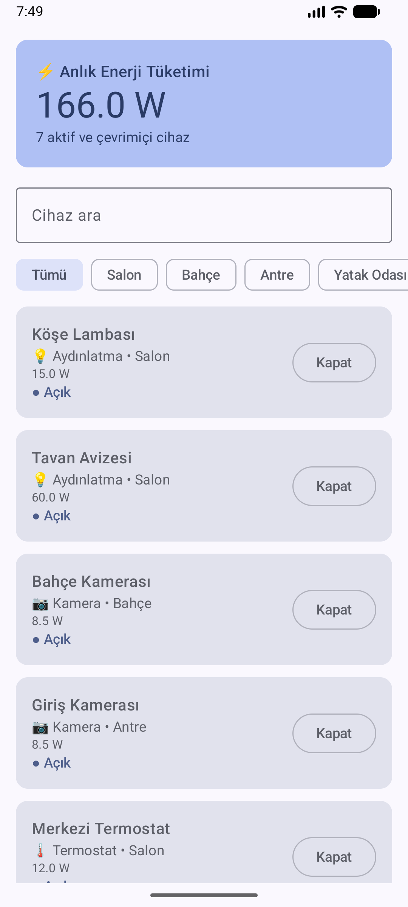
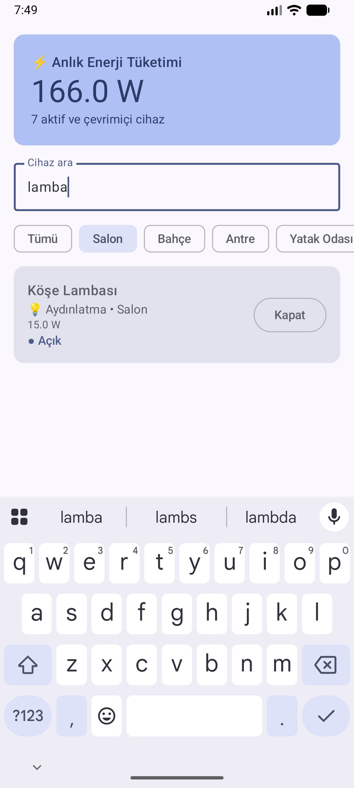

# Akıllı Ev (IoT) Kontrol Merkezi — week3_assignment

Evdeki akıllı cihazların durumunu, odalarını ve enerji tüketimini reaktif olarak yöneten Jetpack Compose uygulaması.

## Özellikler
- **Arama + oda filtresi:** Cihaz adına göre arama ve oda çipleriyle (Salon, Mutfak…) süzme, birlikte çalışır.
- **Reaktif enerji sayacı:** En üstteki kart sadece *aktif ve online* cihazların tüketimini toplar.
- **Aç/Kapat:** Butona basınca cihaz durumu değişir, sayaç anında güncellenir. Offline cihazın butonu devre dışıdır.

## Mimari (MVVM + StateFlow + Coroutines)
```
data/      SmartDevice, DeviceRepository   → tek doğruluk kaynağı (MutableStateFlow)
ui/home/   HomeViewModel                    → combine + flowOn(Dispatchers.Default) + stateIn
           HomeUiState                      → UI'ın ihtiyaç duyduğu her şey hazır hesaplanmış
           HomeScreen                       → stateless Compose UI
```
- **Kural 1 (Katman ayrımı):** Tüm `.filter` ve toplama işlemleri `HomeViewModel` içindedir. Compose katmanında hesaplama yoktur; `HomeRoute` sadece state toplar ve olayları ViewModel'e iletir.
- **Kural 2 (Performans):** Filtreleme ve toplam hesaplaması `flowOn(Dispatchers.Default)` ile Main thread dışında yapılır. Durum değişimi `viewModelScope.launch` + `withContext` ile main-safe çalışır, `MutableStateFlow.update {}` atomiktir. `LazyColumn` `key` kullanır, sadece değişen kart yeniden çizilir.
- UI `collectAsStateWithLifecycle` ile toplar; uygulama arka plana geçince akış durur.

## Testler
`HomeViewModelTest` — enerji toplamı, aç/kapat, offline koruması ve arama + oda filtresi.
```
./gradlew testDebugUnitTest
```

## Ekran Görüntüleri
| Ana ekran | Tavan Avizesi açıldı | Salon + "lamba" |
|---|---|---|
|  |  |  |
